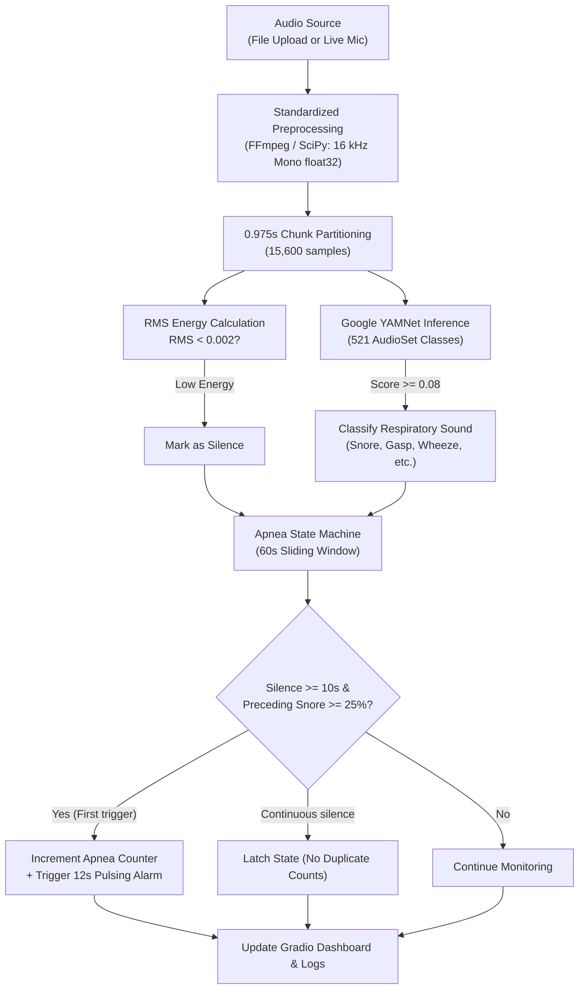

# 🌙 Smartphone-Based Contactless Nighttime Respiratory Monitoring Using YAMNet
---

## 📌 Overview

Sleep-related breathing disorders, especially **Obstructive Sleep Apnea (OSA)**, affect over **936 million adults globally**, with more than **80% remaining undiagnosed**. Untreated sleep apnea causes repetitive nocturnal oxygen deprivation, daytime cognitive exhaustion, hypertension, cardiovascular disease, and increased risk of vehicular accidents.

Traditional diagnostic evaluation relies on **in-laboratory Polysomnography (PSG)**, which is costly (₹15,000–₹50,000), hospital-bound, and requires dozens of intrusive sensors, facial cannulas, and chest belts that disturb natural sleep.

This project introduces a **contactless, zero-cost, smartphone-based acoustic monitoring solution**. Using standard smartphone microphones, nighttime audio is captured, standardized into 0.975-second chunks, classified across respiratory sound categories using **Google's pretrained YAMNet deep neural network**, and analyzed via an energy-based silence heuristic to detect candidate apnea events and sound an automated **12-second alert alarm**.

---

## 🚀 Key Features

- **Zero-Contact & Zero-Cost**: Operates completely from a bedside smartphone or laptop browser without any wearable attachments, patches, or dedicated medical hardware.
- **Deep Acoustic Classification (Google YAMNet)**: Leverages a MobileNetV1 architecture pretrained on Google AudioSet (521 classes) to detect 8 key respiratory and airway effort sounds:
  - *Core Respiratory Sounds:* `Breathing`, `Wheeze`, `Snoring`, `Snort`
  - *Airway Obstruction / Effort Sounds:* `Grunt`, `Groan`, `Gasp`, `Sigh`
- **Dynamic Class Mapping**: Dynamically resolves AudioSet class indices from the official ontology, ensuring resilience against index drift.
- **Robust Candidate Apnea Detection**:
  - Uses Root Mean Square (**RMS**) energy thresholding (`0.002`) to accurately separate quiet room background from acoustic silence.
  - Monitors a **60-second sliding window** for prolonged breathing cessation ($\ge 10\text{s}$ AASM standard, configurable to 5s) following snoring/airway effort ($\ge 2$ snore chunks or $\ge 25\%$ snore ratio).
  - State machine latching ensures prolonged silences count as exactly **1 event** without duplicate alarms.
- **Automated 12-Second Alert Alarm**: Synthesizes an in-memory 880 Hz pulsing alert tone upon apnea event detection to wake the patient or notify a bed partner, with an instant manual 'Stop Alarm' dismiss button.
- **Interactive Dual-Tab Web Application (Gradio)**:
  - **Tab 1 — Upload Sleep Recording**: Process pre-recorded sleep audio/video files (`WAV`, `MP3`, `M4A`, `WEBM`, `FLAC`, `MP4`, `MPEG`) with chunk-by-chunk table inspection and downloadable CSV logs.
  - **Tab 2 — Live Bedside Monitoring**: Real-time microphone audio streaming with incremental chunk evaluation, cumulative event tracking, and live session reset.

---

## 🏗️ System Architecture



---

## 📂 Repository Structure

```text
biodesign_final/
├── sleep_monitor_webapp.ipynb     # Complete interactive Google Colab notebook (Gradio app + tests)
├── Project_Report_Smartphone_Respiratory_Monitoring.docx  # Full BioDesign academic report (Word document)
├── Project_Report_Smartphone_Respiratory_Monitoring.md    # Markdown transcript of the project report
├── Smartphone_Based_Respiratory_Monitoring_YAMNet_Simple.pptx # 16-slide academic presentation deck
├── README.md                      # Project documentation and setup guide
└── test_audio/                    # Benchmark test recordings
    ├── heavy_breath+silence_used_for_apnea.mp3
    ├── heavy_breath+hello.mp3
    ├── only_snoring.mp3
    ├── snoring+hello.mp3
    └── 197454__everythingsounds__snoring.wav
```

---

## ⚙️ Engineering Parameters & Thresholds

| Parameter | Default Value | Clinical & Engineering Rationale |
| :--- | :--- | :--- |
| **Sampling Rate** | `16,000 Hz` | Standard receptive field requirement for Google YAMNet. |
| **Chunk Duration** | `0.975 seconds` | Exactly 15,600 samples; optimal resolution to capture rapid gasps without diluting features. |
| **Snore Score Threshold** | `0.08` (8.0%) | Calibrated threshold among the 8 designated respiratory classes. |
| **Silence Energy Threshold** | `0.002 RMS` | Accommodates ambient room background (fans, AC hum) while cleanly identifying breathing stops. |
| **Apnea Silence Duration** | `10 seconds` | Matches American Academy of Sleep Medicine (AASM) criteria ($\ge 10\text{s}$ cessation of airflow). |
| **Preceding Snore Lookback** | `15 seconds` | Lookback period before silence; requires $\ge 2$ snore chunks or $\ge 25\%$ snore ratio. |
| **Sliding History Window** | `60 seconds` | Retains rolling temporal context for state machine decisions. |
| **Alert Alarm Duration** | `12.0 seconds` | 880 Hz pulsing tone automatically silencing after 12s or on user dismissal. |

---

## 🛠️ Getting Started

### Option A: Running on Google Colab (Recommended)

1. Upload [`sleep_monitor_webapp.ipynb`](file:///c:/Users/USER/Downloads/biodesign_final/sleep_monitor_webapp.ipynb) to [Google Colab](https://colab.research.google.com/).
2. Navigate to **Runtime → Run All** (or press `Ctrl + F9`).
3. Dependencies (`tensorflow`, `tensorflow-hub`, `scipy`, `gradio`, `ffmpeg`) will be installed automatically.
4. When execution reaches the final cell, a **public Gradio URL** (e.g., `https://xxxx.gradio.live`) will be generated.
5. Open this link on your smartphone or browser to test file uploads or live microphone monitoring.

---

### Option B: Running Locally

#### 1. Prerequisites
- Python 3.10 or 3.11
- FFmpeg installed and added to system PATH:
  ```bash
  # Windows (via Chocolatey or winget)
  winget install Gyan.FFmpeg
  
  # Ubuntu / Debian
  sudo apt-get update && sudo apt-get install -y ffmpeg
  
  # macOS
  brew install ffmpeg
  ```

#### 2. Install Python Dependencies
```bash
pip install tensorflow tensorflow-hub scipy gradio pandas numpy
```

#### 3. Launch the Application
```bash
jupyter notebook sleep_monitor_webapp.ipynb
```
Run all cells. The Gradio interface will launch locally at `http://127.0.0.1:7860`.

---

## 📊 Experimental Validation

The pipeline was validated against benchmark multi-event recordings:

| Test Case | Duration | Chunks | Snore Chunks | Snore % | Apnea Events | Detection Latency |
| :--- | :--- | :--- | :--- | :--- | :--- | :--- |
| **`heavy_breath+silence...mp3`** | 81.4 s | 83 | 14 | 16.9% | **1 Event** | ~115 ms / chunk |
| **Real Bedroom Audio Trace** | 54.6 s | 56 | 8 | 14.3% | **1 Event (at 32.2s)** | Real-time |
| **Continuous Silence Latch** | 30.0 s | 31 | 0 | 0.0% | **Held at 1 (No Duplicates)** | Real-time |

### Apnea Detection Trace Example
```csv
Chunk, Time (s),    Detected Sound, Group,         Snore Score %, New Event, Cumulative
22,    20.5 - 21.4, Speech,         -,             2.1%,          0,         0
23,    21.4 - 22.4, Silence,        -,             0.0%,          0,         0
...
32,    30.2 - 31.2, Silence,        -,             0.0%,          0,         0
33,    31.2 - 32.2, Silence,        -,             0.0%,          1,         1  <-- EVENT TRIGGERED (Alarm rings!)
34,    32.2 - 33.1, Silence,        -,             0.0%,          0,         1  <-- LATCHED (No duplicate)
...
53,    50.7 - 51.7, Silence,        -,             0.0%,          0,         1  <-- Sustained silence
54,    51.7 - 52.6, Speech,         -,             0.0%,          0,         1  <-- Arousal: resets gate
```

---

## ⚕️ Clinical & Regulatory SaMD Disclaimer

- **Screening vs Diagnostic Device**: This software is designed strictly as a **low-cost preliminary acoustic screening and triage tool** consistent with Class I / Class II Software as a Medical Device (**SaMD**) principles.
- **No Direct Airflow / SpO2 Measurement**: Acoustic monitoring cannot directly measure nasal airflow cessation, thoracic effort, or arterial oxygen desaturation ($SpO_2$).
- **No False AHI Severity Categorization**: The system intentionally reports *candidate acoustic pause events* and avoids outputting medical Apnea-Hypopnea Index (AHI) severity classifications (Mild/Moderate/Severe OSA).
- **Referral Guidance**: Users exhibiting repetitive candidate apnea events and chronic loud snoring are strongly advised to undergo clinical in-laboratory Polysomnography (PSG) under physician supervision.

---

## 📜 References

1. **Gemmeke, J. F., et al.** (2017). *Audio Set: An ontology and human-labeled dataset for audio events.* Proc. IEEE ICASSP. [AudioSet Ontology](https://research.google.com/audioset/)
2. **Google / TensorFlow Hub.** (2020). *Sound classification with YAMNet.* [TF Hub Model Documentation](https://www.tensorflow.org/hub/tutorials/yamnet)
3. **American Academy of Sleep Medicine (AASM).** (2020). *Clinical Practice Guideline for Diagnostic Testing for Adult Obstructive Sleep Apnea.* [AASM Guidelines](https://aasm.org/)
4. **Nakano, H., et al.** (2019). *Noncontact identification of sleep-disturbed breathing from smartphone-recorded sounds validated by polysomnography.* Sleep and Breathing, 24(2), 527–535.
5. **Kim, T., et al.** (2022). *Evaluating Prediction Models of Sleep Apnea From Smartphone-Recorded Sleep Breathing Sounds.* JAMA Network Open, 5(4), e228126.
6. **Choi, S., et al.** (2023). *Real-Time Detection of Sleep Apnea Based on Breathing Sounds and Prediction Reinforcement Using Home Noises.* JMIR, 25, e44312.

---

## 📄 License

This project is developed for educational and academic research under the **Stanford BioDesign Healthcare Innovation Curriculum** at the **Indian Institute of Technology Kharagpur**. Available under the [MIT License](LICENSE).
